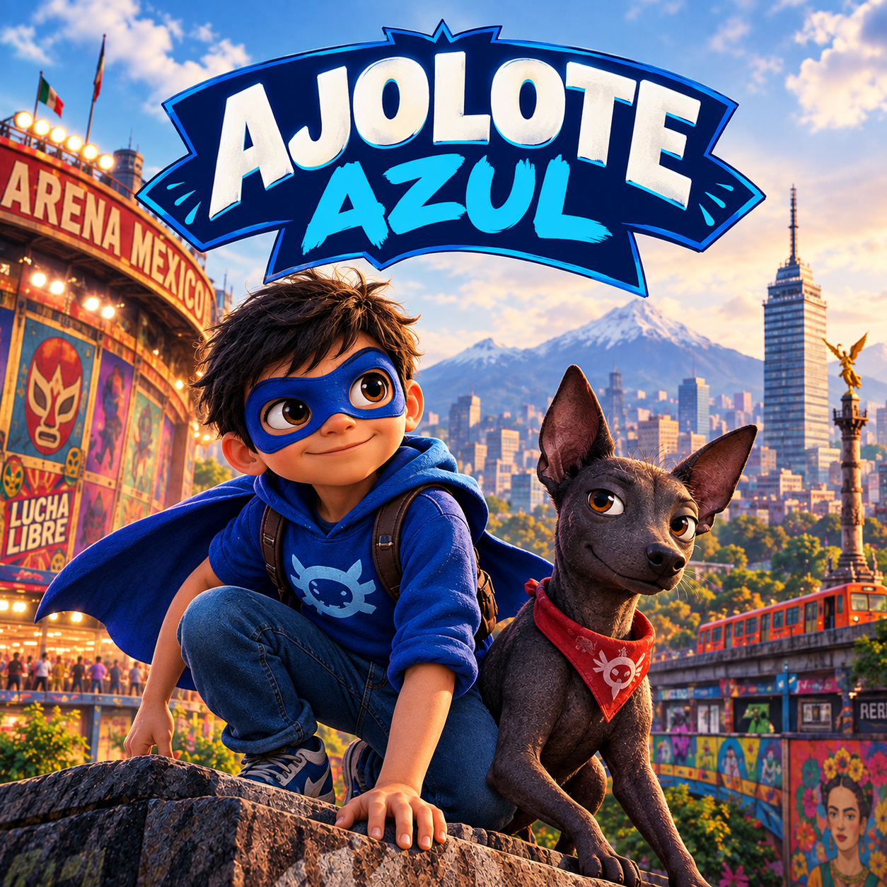

<!-- D.R. © 2026 Bernardo Escalona Espinosa. -->

# Ajolote Azul

Una serie de audiolibros infantiles ambientada en la Ciudad de México contemporánea, escrita y narrada en español.

Ajolote Azul sigue a un niño de 8 años que usa máscara y capa de luchador y genuinamente cree que es un superhéroe, resolviendo misterios del barrio con la ayuda de su perro parlante y de humor seco, Xolo — todo impulsado por la comida de su abuela. Cada episodio es un misterio autoconclusivo de 5 a 10 minutos, arraigado en la cultura auténtica de la Ciudad de México y el argot chilango, con un hilo educativo sutil tejido en la trama en lugar de explicado directamente.

Los guiones se escriben para producirse con motores de texto a voz por IA como ElevenLabs.

## Estructura del repositorio

- [`bible/`](bible/) — la biblia de la serie: premisa, tono, personajes, mundo, lenguaje, continuidad y lineamientos de voz/producción.
  - [`series-bible.md`](bible/series-bible.md) — premisa, tono, filosofía narrativa y educativa, y las reglas fundamentales del mundo de la serie.
  - [`characters.md`](bible/characters.md) — el elenco completo de personajes, incluyendo personalidad, forma de hablar y relaciones.
  - [`world.md`](bible/world.md) — ambientación, barrio de origen y lugares recurrentes.
  - [`language.md`](bible/language.md) — reglas del español chilango y uso del argot.
  - [`voice-bible.md`](bible/voice-bible.md) — dirección de voz por personaje y convenciones de guion para texto a voz.
  - [`continuidad.md`](bible/continuidad.md) — registro de lugares, temas, personajes y hechos ya usados, para mantener consistencia entre episodios.
- [`episodes/`](episodes/) — guiones de los episodios, uno por archivo. Ver [`index.md`](episodes/index.md) para el mapa de la Temporada 1.
- [`research/`](research/) — investigación factual de apoyo, usada para anclar los episodios en la cultura e historia real de la Ciudad de México.

## Estado

La biblia de la serie se está escribiendo primero, para fijar la continuidad, los personajes y el tono antes de redactar los guiones de los episodios.

---

# Ajolote Azul

A children's audiobook series set in contemporary Mexico City, written and narrated in Mexican Spanish.

Ajolote Azul follows an 8-year-old boy who wears a luchador mask and cape and genuinely believes he's a superhero, solving neighborhood mysteries with the help of his deadpan, talking dog Xolo — and fueled by his grandma's cooking. Each episode is a self-contained 5-10 minute mystery, rooted in authentic Mexico City culture and Chilango slang, with a subtle educational thread woven into the plot rather than spelled out.

Scripts are written to be produced with AI text-to-speech engines such as ElevenLabs.

## Repository structure

- [`bible/`](bible/) — the series bible: premise, tone, characters, world, language, continuity, and voice/production guidelines.
  - [`series-bible.md`](bible/series-bible.md) — premise, tone, storytelling and educational philosophy, and the fundamental rules of the show's world.
  - [`characters.md`](bible/characters.md) — full character roster, including personality, speech patterns, and relationships.
  - [`world.md`](bible/world.md) — setting, home neighborhood, and recurring locations.
  - [`language.md`](bible/language.md) — rules for Chilango Spanish and slang usage.
  - [`voice-bible.md`](bible/voice-bible.md) — per-character voice direction and text-to-speech script conventions.
  - [`continuidad.md`](bible/continuidad.md) — tracker of locations, themes, characters, and facts already used, to keep episodes consistent.
- [`episodes/`](episodes/) — episode scripts, one file per episode. See [`index.md`](episodes/index.md) for the Season 1 map.
- [`research/`](research/) — supporting factual research used to ground episodes in real Mexico City culture and history.

## Status

The series bible is being written first, to lock down continuity, characters, and tone before episode scripts are drafted.